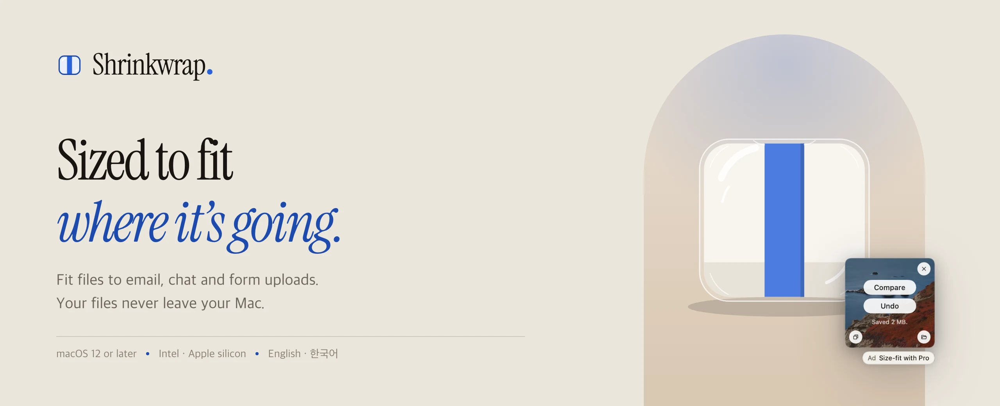
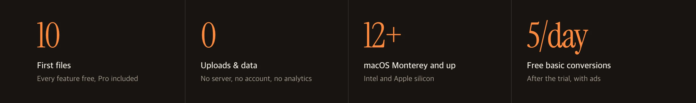
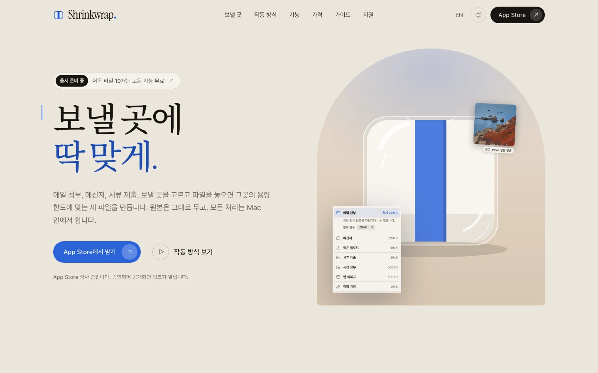
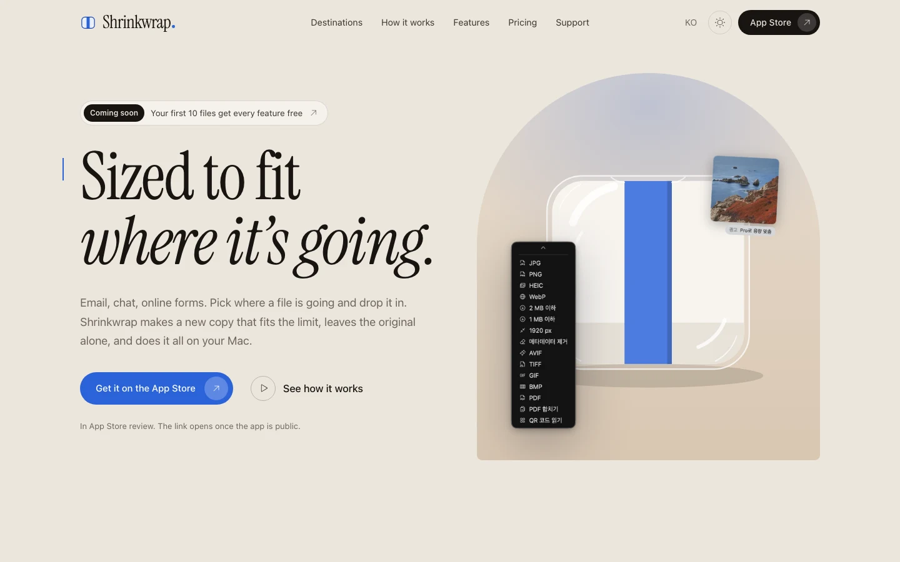
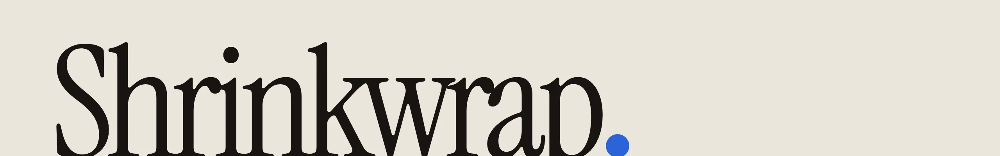

<a href="https://bbdyno.github.io/Kumquat-Page/en/">
  <picture>
    <source media="(prefers-color-scheme: dark)" srcset=".github/readme/hero-en-dark.webp">
    
  </picture>
</a>

<p align="center">
  <a href="https://bbdyno.github.io/Kumquat-Page/"></a>
  <a href="https://github.com/bbdyno/Kumquat-Page/actions/workflows/deploy.yml"></a>
  
  
  
  <a href="LICENSE"></a>
</p>

<p align="center">
  <a href="https://bbdyno.github.io/Kumquat-Page/"><b>한국어 사이트</b></a> ·
  <a href="https://bbdyno.github.io/Kumquat-Page/en/"><b>English site</b></a> ·
  <a href="https://bbdyno.github.io/Kumquat-Page/en/press/">Press kit</a> ·
  <a href="https://bbdyno.github.io/Kumquat-Page/en/privacy/">Privacy</a> ·
  <a href="https://bbdyno.github.io/Kumquat-Page/en/support/">Support</a> ·
  <a href="https://bbdyno.github.io/Kumquat-Page/en/changelog/">Changelog</a>
</p>



Marketing, legal, support and upload-guide pages for **Kumquat**, a macOS file converter. Korean is the default at the site root; English lives under `/en/`. Downloads are App Store campaign links only.

> [!NOTE]
> Kumquat 1.0.0 was submitted to the Mac App Store on 2026-10-20 and is in review. The App Store links start working once the app is public.

## The site

<table>
  <tr>
    <th width="50%">Korean · <code>/</code></th>
    <th width="50%">English · <code>/en/</code></th>
  </tr>
  <tr>
    <td>
      <picture>
        <source media="(prefers-color-scheme: dark)" srcset=".github/readme/site-ko-dark.webp">
        
      </picture>
    </td>
    <td>
      <picture>
        <source media="(prefers-color-scheme: dark)" srcset=".github/readme/site-en-dark.webp">
        
      </picture>
    </td>
  </tr>
</table>

The screenshots follow your GitHub theme, the same way the site follows your system appearance.

| | |
| --- | --- |
| **Stack** | No framework and no npm dependencies. Page modules in `src/pages/` are rendered by `build.mjs` (Node 20+) into `dist/`. |
| **Privacy** | No trackers, no cookies, no third-party font requests. |
| **Type** | Instrument Serif and Noto Serif KR, self-hosted subsets in `public/assets/fonts/` (both OFL, licenses alongside). |
| **Script** | One file, `assets/site.js` (theme toggle, scroll demo, before/after slider, format search). Every page works without it. |
| **Design** | The visual direction and the Pinterest references it came from are in [`DESIGN.md`](DESIGN.md). |

## Commands

```bash
npm run build     # src/ + public/ → dist/ (also writes sitemap.xml and robots.txt)
npm run preview   # build, then serve dist/ at http://localhost:4321/Kumquat-Page/
npm run og        # re-render the placeholder OG images with headless Chrome
npm run readme-art # re-render the README banner, band, footer and site screenshots (needs cwebp)
npm run fonts     # re-subset the serif fonts after heading copy changes (needs: pip install fonttools brotli)
```

Run `npm run build` before `npm run fonts`: the subsetter reads the Korean heading text from `dist/`. Korean heading characters that are not in the subset fall back to the system serif until it is re-run.

The preview server mounts the site under the same base path GitHub Pages uses, so relative links and `404.html` behave like production.

`npm run readme-art` writes `.github/readme/*.webp`. Run `npm run build` first, because the site screenshots are taken from `dist/`. The Korean banner, band and footer are also used by the Kumquat app repo's README; copy `hero-ko-*.webp`, `band-ko.webp` and `footer-*.webp` to `Kumquat/.github/readme/` after re-rendering. The English banner uses the app's English captures in `.github/readme/src/` (from `Kumquat/AppStore/captures`).

## Pages

| Page | Korean | English | Source |
| --- | --- | --- | --- |
| Landing | `/` | `/en/` | `src/pages/00-home.mjs` |
| Privacy Policy (draft) | `/privacy/` | `/en/privacy/` | `10-privacy.mjs` |
| Terms of Use / EULA (draft) | `/terms/` | `/en/terms/` | `11-terms.mjs` |
| Support & FAQ | `/support/` | `/en/support/` | `12-support.mjs` |
| Press kit | `/press/` | `/en/press/` | `13-press.mjs` |
| Changelog | `/changelog/` | `/en/changelog/` | `14-changelog.mjs` |
| Guides index | `/guides/` | — | `20-guides.mjs` |
| Hometax attachment size | `/guides/hometax-attachment-size/` | — | `21-guide-hometax.mjs` |
| Gov24 ID photo | `/guides/gov24-id-photo/` | — | `22-guide-gov24-photo.mjs` |
| 404 | `/404.html` | — | `99-404.mjs` |

Shared header, footer, `<head>` tags (canonical, hreflang, Open Graph) and building blocks are in `src/layout.mjs`. Site settings, prices and the App Store link builder are in `src/config.mjs`. The format table is generated from `src/data/formats.mjs`.

To add a guide: copy a guide module, give it a new `path`, and add it to `src/pages/_guides.mjs`. Files starting with `_` are helpers, not pages.

## Deploy

`.github/workflows/deploy.yml` builds on every push to `main` and deploys `dist/` with GitHub Pages Actions. In the repository settings, set **Pages › Source** to **GitHub Actions**.

## TODO before launch

1. **App Store link.** `APP_ID` is `id6824821095` (1.0.0 submitted for review 2026-10-20). Links carry `mt=12` and a per-CTA `ct` campaign value (`home-hero`, `guide-hometax`, …); the provider token `pt` is left out until it is confirmed in App Store Connect. After approval, change the “출시 준비 중 / Coming soon” chip and the “in review” notes in `00-home.mjs`.
2. **Support email.** `site.email` is `della.kimko@gmail.com`, the same support and ad-report address the app uses.
3. **Site URL.** `site.url` assumes `https://bbdyno.github.io/Kumquat-Page/`. Change it if a custom domain is used; canonical, hreflang, OG and sitemap URLs follow it.
4. **Legal review.** Privacy Policy and Terms are marked as drafts on the page. Fill in the operator's legal name and address, the governing law, and the effective date. Register the terms URL as the custom EULA in App Store Connect, or switch to Apple's standard EULA.
5. **Guide facts.** Both guides tell readers to follow the limits shown on the upload screen. Confirm Hometax size limits and Gov24 photo file requirements, then add them with the date checked (see the TODO comments in each module).
6. **Comparison table.** Tangerine facts were checked on 2026-10-20 (build 2.0.2). Re-check before publishing and after their updates; keep the date in `site.factsDate` current.
7. **Placeholders.** App screens are real captures from the Kumquat repo (`docs/screens/`, development build 2026-10-20; `main-light` is the stats page and `main-dark` the history list, which only exists as a dark capture for now), converted to WebP in `public/assets/shots/` with light and dark versions; refresh them when the UI changes. Recipes, destinations, AI and HWP are labeled as planned (1.1–1.3) everywhere; drop the labels as each ships. No placeholder boxes or annotation labels remain on the site; facts a reader needs (demo data, comparison images) are plain captions.
8. **App 1.0 scope.** Copy only presents what app 1.0 ships (wheel, menu bar drop, Finder Services, Shortcuts, main window with history and stats, conversions, target size 2 MB/1 MB and 10/25 MB for video, crop and rotate, copy as PNG/JPG, image quality setting, QR reading). Recipes, folder watching, destinations and presets, on-device AI, HWP, notch shelf, clipboard automation and the originals vault are labeled as planned. App Review can reject an app whose site or metadata promises more than it does.
9. **Prices and free tier.** Prices mirror `Kumquat/docs/PLAN.md` §2. Free tier (decided 2026-10-20): every feature for the first `welcomeTrialFiles` (10) files, then `freeDailyFiles` (5) basic conversions a day, with ads; Pro has no limits and no ads. Both numbers live in `src/config.mjs`; the landing, terms, privacy, press and Hometax guide copy follow them.

## Sponsor ad list

The app downloads `/ads/v1.json` (source: `public/ads/v1.json`) about once a day to show sponsor ads to free users. It sends no identifiers or usage data, and the privacy policy says so; keep it that way. Format:

```json
{
  "version": 1,
  "updated": "YYYY-MM-DD",
  "ads": [
    { "id": "…", "advertiser": "…", "headline": "…", "body": "…", "url": "https://…", "locale": "ko|en|*", "start": "YYYY-MM-DD", "end": "YYYY-MM-DD" }
  ]
}
```

An empty `ads` array means no sponsors; the app then shows its own Kumquat Pro note. Update `updated` whenever the list changes.

## Credits

Photos (Unsplash License, free for commercial use; credited as a courtesy):

| File | Unsplash photo | Photographer |
| --- | --- | --- |
| `assets/img/hero-kumquats.webp`, OG images | [4rWiSnmX9uY](https://unsplash.com/photos/a-group-of-oranges-4rWiSnmX9uY) | @rens23 |
| `assets/img/ai-bg-before.webp`, `ai-bg-after.webp` | [bcrmOZjw_V8](https://unsplash.com/photos/yellow-round-fruit-on-brown-plant-pot-bcrmOZjw_V8) | Gabriel Miklós (@gebgramm) |
| `assets/img/ai-up-before.webp`, `ai-up-after.webp` | [_qQRpA_HnaI](https://unsplash.com/photos/a-bowl-filled-with-oranges-on-top-of-a-wooden-table-_qQRpA_HnaI) | Joanna Stołowicz (@joanna_stolowicz) |

`ai-bg-after.webp` is a real background-removal result made on this Mac with Apple Vision (`VNGenerateForegroundInstanceMaskRequest`), the framework the app uses. `ai-up-before.webp` is the same crop reduced to 1/5 and enlarged again, to show the difference upscaling targets; it is labeled as a comparison, not as app output.

Icons: [Phosphor Icons](https://phosphoricons.com) Light, MIT (`licenses/phosphor-icons-MIT.txt`), inlined by `src/icons.mjs`. Fonts: Instrument Serif and Noto Serif KR, SIL OFL 1.1 (`licenses/`).

<br>

<p align="center">
  <picture>
    <source media="(prefers-color-scheme: dark)" srcset=".github/readme/footer-dark.webp">
    
  </picture>
</p>
